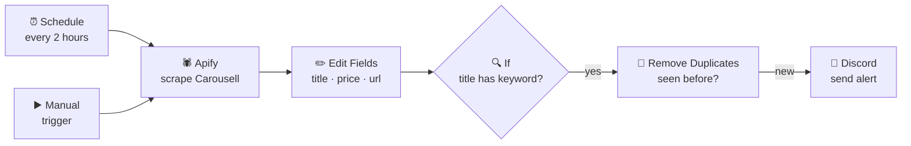

<div align="center">

# 🛒 Marketplace Watcher

**Get a Discord alert the moment a new listing appears on Carousell Malaysia.**

An automation workflow built with n8n and Apify that watches the marketplace for you.


</div>

---

## 💡 The Idea

Good deals on second-hand marketplaces sell in minutes. Refreshing the page all day is not realistic.

**Marketplace Watcher** checks Carousell every 2 hours, finds listings that match a keyword (here: `xbox series`), ignores anything it has already seen, and sends only the **new** ones to Discord.

### Example alert

```
🔔 there is an xbox on the market: RM 1,050  Xbox Series S 512GB with controller  https://www.carousell.com.my/p/...
```

---

## ⚙️ How It Works



| Step | Node | What it does |
|:---:|---|---|
| 1 | **Schedule Trigger** | Starts the workflow every 2 hours (Asia/Kuala_Lumpur time). A manual trigger is included for testing. |
| 2 | **Apify** | Runs the [Carousell Listings Scraper](https://console.apify.com/actors/9XAXWuXpnFXAMmciQ) on the search page, sorted by newest. Returns up to 5 listings. |
| 3 | **Edit Fields** | Keeps only `title`, `price` and `url`. Removes everything after `?` in the URL so the same listing always has the same link. |
| 4 | **If** | Keeps listings whose title contains `xbox series` (not case-sensitive). |
| 5 | **Remove Duplicates** | Remembers every URL from past runs and only lets new listings through. |
| 6 | **Discord** | Sends price, title and link to a channel through a webhook. |

---

## 🧩 Challenge: Getting Past Cloudflare

My first version used n8n's **HTTP Request** node to load the Carousell search page. It did not work.

Carousell is protected by Cloudflare. Instead of listings, the request got back a page saying *"Just a moment... Enable JavaScript"*. The HTTP Request node cannot run JavaScript, so it could never pass this check, even from a home internet connection.

**Solution:** I moved the scraping step to **Apify**. The Apify scraper handles loading the page and returns the listings as clean JSON, which n8n can use directly.

**What I learned:** many modern websites block simple requests, so choosing the right tool for scraping matters as much as the workflow logic.

---

## 🛠️ Skills Shown

- **Workflow automation** — scheduling, branching and chaining nodes in n8n
- **Web scraping** — using Apify to collect data from a protected site
- **Data cleaning** — picking fields and normalizing URLs with n8n expressions
- **State across runs** — de-duplicating results between executions
- **Integrations** — sending alerts through Discord webhooks
- **Cost awareness** — keeping each run small to fit Apify's free plan

---

## 🚀 Run It Yourself

**You need:**
- [n8n](https://n8n.io/) (self-hosted or cloud)
- The Apify community node `@apify/n8n-nodes-apify` (install from **Settings → Community Nodes**)
- An [Apify](https://apify.com/) account and API token
- A Discord channel with a webhook URL

**Steps:**
1. Import `Marketplace Watcher.json` into n8n.
2. In the **Apify** node, add your Apify API token as a credential.
3. In the **Discord** node, add your Discord webhook URL as a credential.
4. Click **Execute workflow** once to test it.
5. Activate the workflow so the schedule starts.

> [!NOTE]
> The first run sends every matching listing, because nothing has been seen yet. After that, only new listings are sent.

> [!IMPORTANT]
> The JSON file contains **no API keys or webhook URLs**. The credential entries are only names that point to credentials in your own n8n, so you need to add your own.

---

## 🎯 Track a Different Product

Change two places:

**1. Apify node input:** put your keyword in the URL
```json
{
  "startUrls": [
    { "url": "https://www.carousell.com.my/search/YOUR%20KEYWORD?sort_by=3" }
  ],
  "maxItems": 5,
  "includeDetails": false,
  "proxyType": "datacenter"
}
```
`sort_by=3` means newest first.

**2. If node:** change the text the title must contain.

---

## 💰 Cost

Apify's free plan gives **$5 of usage per month**. Each run asks for only 5 listings and uses a datacenter proxy to keep the cost low. Running more often uses more credit.

---

## ⚠️ Limitations

- Only the 5 newest listings are checked per run, so if more than 5 appear between runs, some can be missed.
- The keyword filter is simple, so accessories (cases, controllers) that mention the keyword can also pass.
- If the machine running n8n is off, scheduled runs are skipped.
- If Apify credit runs out, runs stop until the next month.

---

## 🗺️ Roadmap

- [ ] Price filter (only alert under a set price)
- [ ] Block accessory words like "case", "controller", "skin"
- [ ] Discord embed with the listing photo
- [ ] Error alert when a run fails
- [ ] Log every listing to Google Sheets to build a price history
- [ ] Watch several keywords from one workflow

---

<div align="center">

Built by **[Anas Ba Bukair](https://www.linkedin.com/in/anas-babukair/)** · [GitHub](https://github.com/AnassSaleh)

</div>
